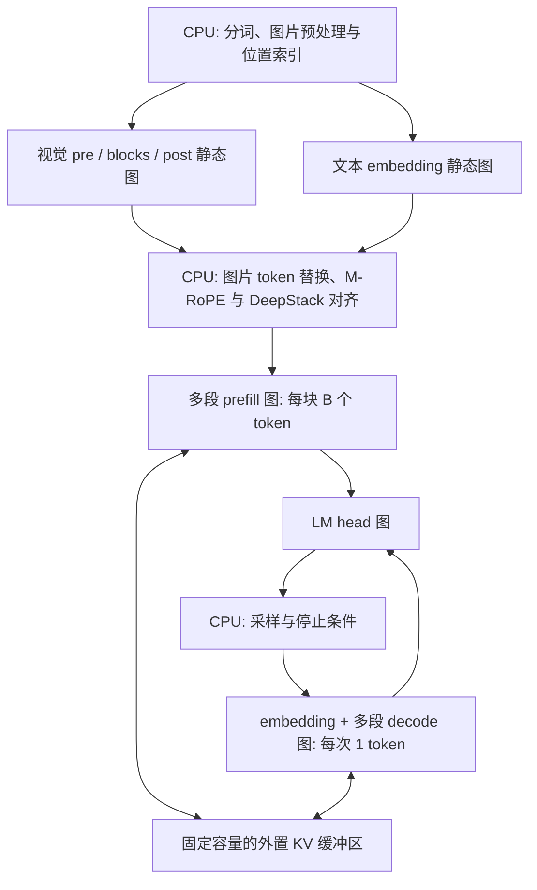

# 全 VLM 静态离线图实验（Kirin9030）

当前操作指南见 [全图 NPU：构建、图权重分离、量化与验证](../../../../docs/inference/full-npu-kirin9030.md)。
2026-10-17 用户最新真机反馈精度阶段性对齐，**性能仍然非常非常慢，后续还需优化**。
以下保留各阶段原始验证范围与失败记录，不以此次反馈改写历史数值报告。

这是一条独立的 **Qwen3-VL/mobi 全模型导出与编译验证路径**，覆盖视觉前后处理、全部视觉 blocks、词嵌入、全部语言模型 layers 和 LM head。现有的六段 ViT W4A16 构建与 App 三条旧推理路径保持原样；新增的全图 App 模式与模型包见本文末。

2026-10-16 已验证静态 KV、分块 prefill 和单 token decode 的主机数学正确性；FP16 权重基线和 GPTQ W4A16 构建各有 **25 张图全部编译成 Kirin9030 纯 NPU OMC，无 CPU 分区**，OMC 总体积分别为 7.77 GiB 和 3.17 GiB。这说明图导出和编译层面可行。**这里的 ONNX 对照结果不是 NPU 精度结论；原始编译目录不能直接当作 App 模型目录。** 新增的 INT8 混合 KV 全图 App 候选见本文末。 本次没有连接或操作手机。原始模型/产物哈希、逐项体积和验证摘要见 [FP16 结果快照](results_kirin9030.json) 与 [W4A16 结果快照](results_w4a16_kirin9030.json)。

## 单图视觉候选 fusedvision_v1（2026-10-17）

模型已发布至 [ModelScope fusedvision_v1](https://www.modelscope.cn/models/fengerhu1/mobi_2B_full_npu_kirin9030_w4a16_g64_kv16_fusedvision_v1)，24 个文件、2,782,486,376 字节已核对远端 SHA256 与大小。请下载到独立目录，旧仓库保留。

将 `vision_pre + vision_blocks_0..5 + vision_post` 八图合成一张 `vision_full`，
全 VLM 共 6 张 OMC。新包格式为 `kirin_full_npu_runtime_v3`，App 本地源码已同步
单图调度与格式检查，仍保留旧包兼容和 16 图 / 4 GiB 预算；需重新构建 App。
本轮未连接、安装或修改手机 App，也未构建 HAP。

图内保留视觉 block 后第 5、11、17 层的特征，各经独立 DeepStack merger，
按顺序注入语言第 0、1、2 层。使用同一冻结 W4/group64 GPTQ、输出范围系数 4，
KV 保持 FP16，图和外置 `.weight` 分离；其余五张语言图和权重直接核验复用。

三张非校准图片上，分图和单图 CPU ONNX 的最终图像 embedding 与每路 DeepStack
逐元素一致，relative L2 / max absolute error 均为 0。104 个视觉 W4 矩阵的编码
及浮点前段核对未变，完整模型共 301 个 W4 矩阵。6 张图纯 NPU 编译通过。
36 项 Python/SDK 检查、九组 C++ 检查通过；实际 App portable C++ 调度器对两条
文本、三张单图和一组双图回放通过 3112 项独立 tensor 检查，覆盖跨 prefill 块、
DeepStack 和全部 28 层 FP16 KV。

以上是 CPU 参考和编译证据，不是端侧 OMC 精度或速度结论。视觉合并减少模型切换，
解码时反复初始化外置权重仍可能主导耗时。以前 W4 质量及长上下文 FP16 KV 的失败
未被宣称解决。复现参数见操作指南的 4.2，数值检查脚本为 `validate_fused_vision.py`。
详细结果见 [融合结果](results_fusedvision_kirin9030.json) 和
[逐路 DeepStack 对照](evidence_fusedvision/fused_vision_validation.json)。


## 缓存恢复与稳定数学修复候选（2026-10-17）

此前授权读取的手机完整日志显示，“你是谁？”生成 25 tokens 用时 59.17 秒，
其中图加载/切换 54.52 秒，缓存命中为零，每步完整写入 224 MiB KV。
手机配置为四图/2048 MiB/256 MiB，与实际单图、无持久 KV 的状态不同。
首个 token 前的 prefill 已偏离同一量化 CPU 参考；六个关键图/权重文件哈希均匹配发布包。
最初触发退让的日志没有保留，不能将其原因断言为设备内存不足。

本次修复把资源恢复改成逐图淘汰，优先保留代价更大的 decoder，不再同时永久关闭
图缓存和 KV 池；新请求与 prefill→decode 切换恢复配置预算。格式未知的 KV 不跨
executor 共享，但同一 executor 的输入仍可增量写入。新日志记录实际预算、格式查询
结果和采样 token ID。App 本地源码已同步；本轮遵照用户要求不再连接手机。

数值修复候选在 RMSNorm 求平方前按行最大绝对值缩放，在 QK MatMul 前分配缩放因子，
并显式稳定 Softmax。它避免依赖编译器保留 FP32 中间计算，不改变数学公式或冻结的
W4/GPTQ 参数。FP16 大残差、attention 点积溢出回归测试与 HF 对照测试通过。
这属于针对已知风险的候选修复，尚未证明它就是手机偏差的唯一原因。

**图与权重已分离**：OMC 图和 `.weight` 文件分别保存，通过 InitWeights 加载。
分离不等于多个 executor 自动共享设备权重；主干矩阵仍为 W4/group64，KV 为 FP16。
修复缓存需重新构建 App；修复导出数学还需使用新模型包。纯 NPU 编译与 CPU 通过均不
代表新包真机数值和速度已通过验收。

新候选已发布到 [ModelScope stablemath_v1](https://www.modelscope.cn/models/fengerhu1/mobi_2B_full_npu_kirin9030_w4a16_g64_kv16_stablemath_v1)，
37 个文件、2,785,113,131 字节已逐项校验远端大小与 SHA256。请使用独立下载目录，
配合重新构建的 App；旧仓库没有覆盖更新。本轮完成 13 张纯 NPU 图编译、301 个
W4 矩阵编码核对、35 项 Python/SDK 测试及九组 C++ 测试。实际 App C++ 调度器
在三条文本和一张图片的 CPU ONNX 回放中通过 2928 项独立张量检查，覆盖全部 28 层
FP16 KV。这些不是 OMC 真机推理。完整记录见
[修复结果](results_stablemath_cache_kirin9030.json) 和 [App 源码补丁](evidence_stablemath_cache/app_runtime.patch)。

有限精度与量化取整使等价公式产生不同 logits；新候选相对旧 CPU 参考的首 token
logits relative L2 最大为 0.0929。新候选 Torch 与 ONNX 的逐图最大 relative L2
为 0.01555，比较对象不同，不能将其解释为原始浮点模型的量化损失。此前 W4 质量
及长上下文 FP16 KV 的验收失败没有被宣称解决；App 尚未构建 HAP 或安装到手机。

## 外置权重与 FP16 KV 新候选（2026-10-16）

本节对应用户报告“反复加载很慢、回答无关”之后的新构建。此前的 `embsplit`
包及下文旧结果保留作对照；**新候选需要新 App 与新模型包同时更换**。

用户后续设备日志在首张 `embedding_decode` 的 Build 前报告 InitWeights 接口未找到。
上一版只查 `dlsym(RTLD_DEFAULT, ...)`，这不能排除接口存在于局部加载的 HiAI 库。
现改为与 Lite 一致，先 `dlopen("libhiai_foundation.so", RTLD_LAZY | RTLD_LOCAL)`，
从库句柄查找 `HMS_HiAIExecutor_InitWeights`，再保留全局查找作为兼容路径；
库句柄保留到全部 executor/compilation 销毁之后。没有修改模型包或 W4/FP16 KV 参数。

新增 `step=resolve_HMS_HiAIExecutor_InitWeights` 记录 HiAI 版本、库打开结果、
`lookup=library_handle/global_fallback`、实际 provider 路径及 `dlerror()`。
查找失败不再仅凭全局表就断言设备不支持。真实局部共享库测试证明旧代码失败、
新代码成功；库存在但缺符号、库不存在两种情况仍在 Build 前明确失败，旧内嵌包可加载。
九组 C++ 测试通过，另使用 App 中同步的 C++ 源码验证局部库场景。
这不证明用户手机一定提供接口；若显式库查找也失败，当前 App 可访问的库仍无法
使用外置权重包，需要根据新日志区分库加载限制与接口缺失，不能跳过初始化继续运行。
本次只需重建安装 App，继续使用已下载模型。记录见
[接口查找修正](results_hiai_symbol_lookup_kirin9030.json)。

新模型已发布到 [fengerhu1/mobi_2B_full_npu_kirin9030_w4a16_g64_kv16_external](https://www.modelscope.cn/models/fengerhu1/mobi_2B_full_npu_kirin9030_w4a16_g64_kv16_external)。
在 App 的模型下载地址填入该仓库，下载到独立目录，使用重新构建的 App 选择
**全图 NPU**。远端 40 个文件的大小及 SHA256 已核对，旧 `embsplit` 仓库保留。

复核了 MindSpore Lite 官方 `lite_llm` 的
[编译器](https://github.com/mindspore-ai/mindspore-lite/blob/ed913aad743379cb38aec529210263abe8d8115b/mindspore-lite/lite_llm/export/utils/omc_compiler.py)、
[NNRT executor](https://github.com/mindspore-ai/mindspore-lite/blob/ed913aad743379cb38aec529210263abe8d8115b/mindspore-lite/lite_llm/src/backend/nnrt/nnrt_executor.cc)
和 [KV 实现](https://github.com/mindspore-ai/mindspore-lite/blob/ed913aad743379cb38aec529210263abe8d8115b/mindspore-lite/lite_llm/src/backend/nnrt/nnrt_kvcache.cc)。
当前 DDK 支持 `--save_weights_as_external_data=true`，实际输出小型 `external.omc`
与 `SubGraph_0.weight`。运行时按 Build → Construct executor →
`HMS_HiAIExecutor_InitWeights(executor, directory)` → 校验端口加载；保留 compilation
到 executor 释放。缺少设备 API 或权重文件时明确失败，不会把外置包当成内嵌 OMC。

这复用了官方的分离加载方式，没有声称已经移植 Lite 的全部 Qwen/VLM 管线。
其 Q4_0 依赖额外 `mslite_llm_ops` wheel 与配套 AscendC 自定义算子安装包；本机
发行物不含完整依赖。因此保留已能编译的 SDK `Quant_act_weight_eco` / `Quant_lm_head`
W4/group64 GPTQ 路径：主干及 head 的矩阵权重为 4 bit，embedding/位置表等保留
FP16；A16 在这里包含 SDK 的 **INT16 激活量化**，不等于所有激活都是 FP16。

新结构把 28 层语言主干合成一张 prefill、一张 decode 图，不再分成七段，
embedding 恢复为每阶段一张图。新候选的 13 张 OMC 已全部编译成纯 NPU；解码只需同时保留
embedding、整段 decode、head 三个模型。默认最多 4 图、文件及外置权重预算
2048 MiB。只有文件名与 SHA256 都相同的权重文件才共享磁盘目录；这不代表
两个 executor 自动共享设备权重。prefill 模型在转入 decode 前释放。

| 项目 | 旧 embsplit + 四图缓存 | 新外置权重候选 |
| --- | ---: | ---: |
| 完整 VLM 物理 OMC 数 | 39 | 13 |
| 每 token 调用的图 | 16 | 3 |
| 热身后每 token Build 次数（主机替身） | 13 | 0 |
| 宿主 KV 容量 | 140.44 MiB | 224 MiB |
| 每 token 的增量写入 | 175 KiB | 112 KiB |

零重建要求设备能同时持有三个模型；发生资源回退时不成立。FP16 增量写入较少，
是因为取消了 INT8 scale 及另外一份 recent FP16 窗口，不能据此推导其设备读取
开销更小或全部场景更快。

KV 改为 FP16，每层只有 K/V 两个固定容量输入，省去旧 INT8 的反量化、scale、
sink/recent 窗口。宿主缓存 224 MiB，独立 NNRT 持久输入池同为 224 MiB，池预算
256 MiB。首次完整同步，随后按有效长度写新增行：28 层每新增 token 共 112 KiB。
它仍是固定长度 attention，不是图内原地 KV 更新，也不能将写入字节数当作设备总流量。
资源失败保留单图/完整同步回退，回退后速度可能重新下降，日志会记录 `cache_backoff`。

旧量化参考存在激活截断。冻结原始 W4 权重后，比较权重单独量化和完整 SDK
输入/输出量化；仅将输出量化范围扩大 4 倍、保持输入与权重范围不变，部分文本
回答明显改善。此参数从三个诊断问题选择，另有五条未参与选择的文本检查。
十条文本与三张非校准图片的生成回答、teacher-forced NLL、logits 和独立 KV
误差均保留在审计报告，不能作为完整准确率或正式 benchmark。
三张图片首 token logits 相对原始浮点的 L2 误差约 0.53–0.57，仅 W4 权重
约 0.41–0.47，说明剩余偏移同时涉及权重和激活；相关回答不代表数值已对齐。

原始记录保存在 [修正前文本](evidence_external_w4_kv16/quantization_before.json)、
[修正后文本审计](evidence_external_w4_kv16/quantization_audit.json)、
[图片生成](evidence_external_w4_kv16/image_quantization_audit.json)、
[图片权重/激活对照](evidence_external_w4_kv16/image_logit_audit.json) 与
[FP16 KV 检查](evidence_external_w4_kv16/kv_validation_torch.json)。

FP16 KV 对照保持原 relative-L2 阈值 0.05：短文本、算术与图片通过；约 1802
个 prompt tokens 的长上下文中 logits 最大误差约 0.0232，但逐层 KV 最大误差
约 **0.2759**，因此整体 **未通过**。文本生成仍有“地球反射太阳光形成月亮”等
事实错误，图片仍有 OCR/细节损失。不能凭编译成功、贪心 token 相同或调度检查
通过宣称数值精度已经修复，设备输出还需单独对齐。

构建入口 `external_weights.py` 从已经冻结且有哈希记录的 W4 校准构建读取权重，
创建独立目录；不会重新 GPTQ，也不会改旧包。示例：

```bash
python external_weights.py --source-build /path/to/frozen_w4_build \
  --output /path/to/new_external_build --model /path/to/original_hf_model \
  --ddk /path/to/DDK-tools-next-6.1.1.0 --kv-dtype fp16 \
  --layers-per-chunk 28 --output-range-multiplier 4 --steps prepare,export,compile
python package_runtime.py --build /path/to/new_external_build \
  --model /path/to/original_hf_model --tokenizer /path/to/tokenizer.mtok \
  --output /path/to/new_empty_package
```

交付候选目录为 `/tmp/kirin_full_npu_external_w4_kv16_output4_release`，约 2.59 GiB。
13 张纯 NPU OMC 的本体合计约 25.31 MiB，12 组外置权重中仅 embedding 的
prefill/decode 文件完全相同，按哈希去重。三个解码模型的序列化图与权重合计
约 1584.92 MiB，实际设备峰值另含 KV、激活及驱动工作区。

32 项 Python 测试（含官方 SDK）与六组 C++ 测试通过；使用实际 App 复制源码
编译的主机调度器，在文本、三张单图和两张图同请求五个场景中，共完成 2985 项
独立 tensor 检查。包含 system 模板、跨块 prefill、两种图片标签顺序、全部
28 层 FP16 KV 与八个生成 token。此回放使用反量化 CPU ONNX，未执行 OMC。
结果快照见 [外置权重审查结果](results_external_weights_kirin9030.json)。

格式为 `kirin_full_npu_runtime_v2`，旧 App 不支持。App 同步还包含 native 模式
检查、Profile 页面格式识别及动态库链接。主机测试使用 NNRT 调用替身，不能
替代 HAP 构建、真机多图常驻、设备 API 可用性、峰值内存或吞吐测试。

## 官方能力与实际限制

华为 OMG 支持 `--input_shape` 中使用 `-1`，再通过 `--dynamic_dims` 枚举形状组合，最多 16 档。这属于有限形状枚举，不能直接推导出任意长度动态 KV、图内状态更新或自回归循环可用。离线设备产物需要 `--target=omc` 和匹配的 `--platform`；`om` 是另一种硬件无关 IR 目标。参见 [OMG 总体参数说明](https://developer.huawei.com/consumer/cn/doc/harmonyos-guides/cannkit-overall-parameter)。

`HMS_HiAIOptions_SetDynamicShapeStatus/MaxCache/CacheMode` 的说明针对**编译前设置的动态形状缓存**，变化形状数量不超过 10，不能等同于设备侧自动增长的 KV Cache。参见 [CANN Kit API](https://developer.huawei.com/consumer/cn/doc/harmonyos-references/cannkit)。

官方另有独立的 [LLM Engine API](https://developer.huawei.com/consumer/cn/doc/harmonyos-references/cannkit-llm-engine)，包含 executor、context、文本/token 输入及 prefill/decode 指标。公开接口本身不足以确认任意自定义 Qwen3-VL 的视觉特征、M-RoPE 和 DeepStack 注入都能直接接入；本实验没有将它当作已经验证的替代方案。文档的新接口版本与项目现用设备侧 SDK 版本也需要分别核对。

### 本机两档动态图试验

使用原始模型的真实第 0 层，固定 KV 容量 128，尝试把 `S=16` prefill 与 `S=1` decode 放进同一张图：

- ONNX 两档形状的 Torch/ORT 对照均通过，最大 relative L2 约为 `9.973e-7`。
- DDK-tools-next-6.1.1.0 / Kirin9030 在生成、合并形状子图时失败，最终没有可用的动态 OMC。
- 关键日志是 `enum_shape_compiled_model.cpp` 的 `CheckWeightList` 中 `srcBuffers[i].GetSize() == dstBuffers[i].GetSize()` 失败，随后 `AddCompiledModel`、`GenerateOMCModel` 失败。

这证明**这个具体图和 SDK 组合不能按该方式合并**。日志还不足以区分学习权重的布局差异、随形状变化的常量或 SDK 实现问题，更不能据此宣称麒麟完全不支持动态形状。因此实现采用两套独立静态图，不依赖动态档位共享权重。原始试验与日志保存在本机 `/tmp/kirin_dynamic_phase_probe/`。

## 图和调度接口

以当前 mobi 2B 为例：语言模型 28 层，H=2048，16 个 Q heads、8 个 KV heads、head_dim=128；视觉模型 24 层，H=1024，并有 3 份 DeepStack 特征。



图中计算模块是离线编译目标；主机调度已经用 Torch/ORT 实现，新增 C++ 调度和 NNRT 适配器见本文末，设备执行仍待验证。这里的“全模型”指神经网络计算组件，不包括把分词、文件解码、采样或生成循环也塞进一张 OMC。

每层 K、V 分别固定为 `[1, kv_heads, C, head_dim]`。有效长度 `P` 由外部保存，不改变 tensor shape：

1. prefill 每块输入固定 `B` 个 token；尾块不足时补零，只提交真实 `N` 个 token。decode 使用单独的 `S=1` 图。
2. 图内将完整容量的旧 KV 与当前 `S` 个新 KV 拼接，attention mask 固定为 `[1,1,S,C+S]`。仅旧 `[0,P)` 和当前块的真实因果前缀可见。
3. 每张 decoder 图输出 hidden 和各层的 **delta K/V**；外部将真实部分写入 `[P:P+N]`。同一块的所有 layers 成功后才推进全局有效长度。
4. 调用失败会回退有效长度，重试时覆盖未提交区域；超出容量明确报错，不静默丢弃上下文。
5. GQA 把 query groups 折入 query 维，避免五维 Expand 与重复整份 KV。M-RoPE 的 cos/sin 为显式输入；图像的 DeepStack 特征按全局 token 位置注入前 3 个语言模型 layers，不能在每个 prefill 块重新从图片开头计数。

例如 168-token prompt 先运行 128 个，再运行补齐到 128 的 40 个真实 tokens，缓存有效长度依次为 `0 → 128 → 168`。下一步 decode 读取旧 `[0,168)`，屏蔽旧 `[168,2048)`，再让 query 看见当前生成的新 key。新 key 在图内临时拼接到容量之后的第 2048 个槽位，输出后外部把它写回缓存第 168 个槽位，长度变成 169。物理上的临时拼接位置不用于计算 M-RoPE 位置。

这是**外置缓存的静态图协议**，没有在 OMC 内部维护会话状态或扩大 tensor。历史 K/V 不会重算，但仍参与每步 attention；Python 参考调度默认使用 NumPy FP32，也可显式选择下文的 FP16 / INT8 缓存，还没有实现设备共享缓冲区。对应实现是 `StaticDecoderLayer.forward` 的拼接、`attention_mask` 的有效区间，以及 `KVCache.append_chunk/commit` 的增量写回。单独启用 4bit 权重量化不会压缩 KV。

默认 `C=2048, B=128`，每 4 层一个 chunk，共 25 张图：

| 组件 | 图数 | 说明 |
| --- | ---: | --- |
| 语言模型 prefill | 7 | 全部 28 层，固定 S=128 |
| 语言模型 decode | 7 | 同样 28 层，固定 S=1 |
| embedding | 2 | prefill/decode 各一张 |
| LM head | 1 | 最后一个有效 token 的 norm + 全词表投影，两阶段共用 |
| vision pre | 1 | 原始 Conv3D patch embedding 等价展开为 Linear；学习位置嵌入与插值计算 |
| vision blocks | 6 | 全部 24 层及 DeepStack 中间特征 |
| vision post | 1 | 最终 merger 和 3 个 DeepStack mergers |

当前只支持 batch=1、Qwen3-VL 架构、单张固定 patch 数量的图片；不支持视频、滑窗、beam search 或自动上下文扩容。更换容量、prefill 块大小或视觉 patch 数量需要新的构建目录。模型路径、平台与这些形状参数均可配置。

上面的 FP16 基线 ONNX 图 I/O 为 FP32（token IDs、位置索引为 INT32），OMG 使用 `--weight_data_type=FP16`，**不使用 `compress_conf`，没有 DOPT 校准或 W4/W8 量化**。这与已有 ViT W4A16 发布包是不同实验；内部执行精度还需设备 tensor descriptor 和数值验证，不能仅凭编译参数称为已验证的 W16A16。另有下文的 W4A16 路径。

## 已完成的主机验证

环境：Python 3.10，Torch 2.6.0、Transformers 5.16.1、ONNX 1.22.0、ORT 1.23.2；参考为原始 HF 浮点权重、FP32 eager attention。没有加载 fake-quant checkpoint。

25 张导出图全部完成逐图 Torch/ORT 对照，最大输出 relative L2 约为 `1.402e-5`。另把导出 ONNX **完整串联**，与原始 HF VLM 对比：

| 样例 | prefill | 后续 decode | 最大 logits relative L2 | 最大 KV relative L2 | 贪心 token |
| --- | --- | ---: | ---: | ---: | --- |
| 纯文字 | 13 tokens，尾块补齐到 128 | 8 步 | `2.35e-6` | `2.46e-6` | 全部相同 |
| 真实图片 + 问题 | 168 tokens，分为 128+40 | 8 步 | `2.45e-5` | `2.94e-5` | 全部相同 |

图片预处理后的网格为 `[1,38,16]`，608 patches / 152 个视觉 tokens。图片 embedding relative L2 约为 `7.225e-6`，DeepStack 为 `4.59e-6`。图片样例的 prefill normalized hidden relative L2 约为 `3.083e-5`。判定要求 shape、有限值、relative L2 ≤ `2e-4`，同时检查生成 token 和全部 28 层有效 KV。

这验证了**原始模型 → 静态化 → ONNX → 分块串联**的数学行为，覆盖跨 prefill 块的图片位置、尾块 padding 和重复 decode；样本量仍很小，且不能说明 NPU FP16 执行误差、长上下文质量或速度。

## 完整模型编译实测

DDK-tools-next-6.1.1.0 / Kirin9030，25/25 图均有 `partition type NPU:1, CPU:0, GPU:0, ISP:0`、内存分配与最终离线模型保存成功证据。逐一重新核对 ONNX、其引用的外部权重和 OMC SHA256 后通过，没有只按退出码或文件存在判定。10 项回归测试通过。

| 组件 | OMC 总体积（MiB） |
| --- | ---: |
| LLM prefill 7 段 | 2698.46 |
| LLM decode 7 段 | 2697.80 |
| embedding 两阶段 | 1187.01 |
| 共用 LM head | 593.68 |
| vision pre + 6 段 blocks + post | 782.00 |
| 总计 | **7958.95 MiB / 7.77 GiB** |

这批浮点权重产物确实很大；不能因为能编译就认为适合在手机上全部常驻。文件体积也不能直接当作运行时内存峰值。本机完整产物与逐图编译日志在 `/tmp/kirin_full_vlm_static/`，没有复制进仓库或 App。

## 在主机复现

在仓库根目录执行。使用已包含 Torch、Transformers、ONNX、onnxsim、ORT、safetensors 和 Pillow 的环境；视觉验证针对上述 Transformers API 版本，升级时应重新运行测试。SDK 初始化按仓库 `CLAUDE.md` 的 AscendC 环境要求完成。

```bash
KIRIN_PYTHON=/path/to/CANN/bin/python
KIRIN_MODEL=/path/to/original_hf_model
KIRIN_DDK=/path/to/DDK-tools-next-6.1.1.0
KIRIN_BUILD=/path/to/new_empty_build_directory
KIRIN_IMAGE=/path/to/image.jpg
KIRIN_SCRIPT=transformers/llm/export/kirin_llm_offline/experiment.py

# 固定 KV 数学、尾块、DeepStack、失败重试和实际 ONNX 导出的回归测试
PYTHONDONTWRITEBYTECODE=1 "$KIRIN_PYTHON" -B -m unittest discover \
  -s transformers/llm/export/kirin_llm_offline -p 'test_*.py' -v

# 从原始权重验证静态 Torch，并导出全部 ONNX 图
"$KIRIN_PYTHON" -B "$KIRIN_SCRIPT" \
  --model "$KIRIN_MODEL" --output "$KIRIN_BUILD" \
  --platform kirin9030 --context 2048 --prefill-tokens 128 \
  --layers-per-chunk 4 --vision-layers-per-chunk 4 --vision-tokens 608 \
  --image "$KIRIN_IMAGE" --image-height 608 --image-width 256 \
  --decode-steps 8 --steps validate,export

# 完整 ONNX 串联对照；需要上一阶段导出的所有组件
"$KIRIN_PYTHON" -B "$KIRIN_SCRIPT" \
  --model "$KIRIN_MODEL" --output "$KIRIN_BUILD" \
  --image "$KIRIN_IMAGE" --decode-steps 8 \
  --validation-backend onnx --steps validate

# 批量生成 Kirin9030 硬件离线图，拒绝 CPU fallback
"$KIRIN_PYTHON" -B "$KIRIN_SCRIPT" \
  --model "$KIRIN_MODEL" --output "$KIRIN_BUILD" \
  --ddk "$KIRIN_DDK" --platform kirin9030 --steps compile
```

同一构建目录必须始终使用相同的形状/平台参数；上面后两步省略的参数与第一步默认值相同。图片尺寸经 HF processor 得到的 patch 数量须等于 `--vision-tokens`。只验证文字时可省略 `--image`。CPU 验证只运行导出的浮点 ONNX，不会读取或执行 OMC。

可以选择任意阶段、组件和 decoder chunks，例如仅导出或编译第 0 段 decode：

```bash
"$KIRIN_PYTHON" -B "$KIRIN_SCRIPT" \
  --model "$KIRIN_MODEL" --output "$KIRIN_BUILD" --ddk "$KIRIN_DDK" \
  --components llm --modes decode --chunks 0 --steps export,compile
```

`--steps` 按所给顺序执行；ONNX 验证必须在导出之后。FP16 模式未指定时依次运行 `validate,export,compile`，其验证后端为 Torch。仅编译时不加载 HF 权重，不重新导出。重新导出某张图会撤销它的旧编译记录，需要重新编译。脚本不会自动跳过以前编译成功的选择项，可通过组件/阶段/chunks 选择范围。不要并发运行两个写入同一构建目录的命令。

构建目录包含 `manifest.json`、`host_validation_<backend>.json` 和 `graphs/<name>/{model.onnx,*.pb,compile.log,model.omc}`。manifest 记录图接口、外部权重 SHA256、逐图误差、编译产物 SHA256，以及 `device_tested=false/app_integrated=false`。编译与 ORT 加载会核对输入文件哈希。SDK 临时路径默认在 `/tmp`，可用 `--compiler-work-dir` 配置，但该路径仅允许 ASCII 字母、数字、`/`、`_`，以避开 SDK 路径限制。

## W4A16 权重量化

入口仍是 `experiment.py`，增加 `--precision w4a16`。采用 [华为插件式量化](https://developer.huawei.com/consumer/cn/doc/harmonyos-guides/cannkit-plug-in-quantification) 的接口及原生编码，策略配置参考 [三段式量化说明](https://developer.huawei.com/consumer/cn/doc/doccenter-capabilities/cannkit-llm-three-stage-quantification)，评估遵循 [量化效果评估](https://developer.huawei.com/consumer/cn/doc/doccenter-capabilities/cannkit-llm-quantization-effect-evaluation) 的冻结 checkpoint 仿真方法。

支持 `--weight-method rtn`（直接取整，默认兼容路径）和 `--weight-method gptq`。本次初始 RTN 候选出现过自我介绍循环重复，因此后续使用 GPTQ。这里的 [GPTQ](https://arxiv.org/abs/2210.17323) 是基于真实输入 Hessian 的权重误差补偿：冻结 SDK 的 INT4/group64 scale，按重要性处理列后恢复原始列顺序，不改变硬件要求的连续分组；逐矩阵比较校准重建误差，保留优于 RTN 的结果。**这不是完整复现华为的一站式 KD/QAT 训练流程。**

- LLM 的 attention/MLP、视觉 blocks 和视觉 mergers 的 Linear 使用 `Quant_act_weight_eco`、W4/group64、signed INT16 输入、逐通道 INT16 输出。LM head 使用 `Quant_lm_head`，默认同样为 W4，也可显式 `--head-bit 16`。
- embedding、原始 patch Conv3D 和学习位置表保留浮点；attention、norm、residual 等计算也没有变成 4bit。默认 ONNX I/O 为 FP32/INT32，显式启用 KV 压缩后缓存端口另有 INT8 / FP16；设备 I/O 以实际 NNRT descriptor 为准。GPTQ 单独处理与 embedding 共享的 head，保存和重载时均解除共享，避免修改浮点 embedding。
- 默认校准 16 组真实输入：8 张图片、8 条文字，每组包含 prefill 和 4 步 decode。支持自定义样本数、图片目录和 `{text: prompt}` 格式的 JSON 文本集。首组使用图片，让全部视觉、语言和 head 量化器均得到输入。head 使用 prefill 全部位置校准，避免只凭一个 logits 向量确定逐通道输出范围。
- prefill/decode 共用同一份完整模型校准 checkpoint，同一 decoder chunk 的参数文件只生成一次；两阶段 graph entry 引用相同路径和 SHA256。
- SDK 的 `quant_param_2=True` 输出 UINT4/LUT 索引及配套 `quant_params_file`。编码、LUT+scale 还原和每个 ONNX MatMul initializer 均做逐值配对检查；编码图保留 FLOAT32 索引容器，OMG 使用 `compress_conf` 消费它，不能把索引图直接交给 ORT 评估。
- 每个量化图另存 `reference/model.onnx`，包含反量化权重以及 SDK 的输入/输出量化操作。`ONNXGraphs` 自动读取这份 CPU 参考图。导出时使用真实图片 prompt 串联静态模型得到的输入与历史 KV，不用随机中间层输入代表量化数值稳定性。
- 手动调用 attention 内的投影会跳过 HF 父模块的 forward 作用域，使 ONNX 算子名与 SDK 模块路径不同；导出器在逐值核对对应权重后重命名 MatMul，保证参数文件确实指向该算子。
- `quality` 分别生成原始浮点模型、SDK 量化 HF 模型和静态 KV 量化模型的真实贪心回答，不要求量化前后逐 token 相同。验证图片从校准集排除。

冻结后的 SDK 权重量化只计算一次并缓存反量化结果，激活量化仍使用原 SDK 模块；回归测试要求缓存前向与官方量化前向逐值一致。这避免每步 CPU decode 重复量化整份大权重，没有改变量化算法或校准状态。

验证分开执行两项：**仅 W4 权重、暂时绕过激活量化**时，仍要求静态模型相对完整 HF 的 relative L2 ≤ `2e-4` 且贪心 token 全部相同，作为 KV/结构转换的严格检查；打开 A16 输入/输出取整后，记录完整数值误差与 token 一致率，默认 `--alignment-rtol 0.05`，不强制贪心完全一致（可用 `--strict-greedy` 加严）。这是量化参考的稳定性检查，不是“相对原始浮点模型只有 5% 误差”的承诺，也不是 NPU 精度验收。FP16 基线保留原来的 `2e-4` 和严格贪心要求。

使用新的构建目录，不覆盖 FP16 基线：

```bash
KIRIN_W4_BUILD=/path/to/new_w4_build
KIRIN_CALIB_IMAGES=/path/to/calibration_images
KIRIN_QUANT_PYTHON=/path/to/cuda_enabled_python

# 量化测试额外需要可用的 SDK
KIRIN_TEST_DDK="$KIRIN_DDK" PYTHONDONTWRITEBYTECODE=1 "$KIRIN_PYTHON" -B \
  -m unittest discover -s transformers/llm/export/kirin_llm_offline -p 'test_*.py' -v

# GPTQ/激活校准使用 CUDA Torch；其余阶段可以使用原来的 CPU CANN 环境
"$KIRIN_QUANT_PYTHON" -B "$KIRIN_SCRIPT" \
  --model "$KIRIN_MODEL" --output "$KIRIN_W4_BUILD" --ddk "$KIRIN_DDK" \
  --precision w4a16 --weight-method gptq --group-size 64 --head-bit 4 \
  --quant-device cuda:0 --gptq-damping 0.01 --gptq-block-size 128 \
  --calibration-images "$KIRIN_CALIB_IMAGES" --calibration-samples 64 \
  --calibration-decode-steps 4 --image "$KIRIN_IMAGE" --steps calibrate

"$KIRIN_PYTHON" -B "$KIRIN_SCRIPT" \
  --model "$KIRIN_MODEL" --output "$KIRIN_W4_BUILD" --ddk "$KIRIN_DDK" \
  --precision w4a16 --weight-method gptq --group-size 64 --head-bit 4 \
  --image "$KIRIN_IMAGE" --decode-steps 8 --quality-tokens 48 \
  --validation-backend onnx --steps export,validate,quality,compile
```

W4A16 模式默认阶段为 `calibrate,export,validate,quality,compile`；也可分阶段执行，之后仍需传相同的 `--precision/--weight-method/--group-size/--head-bit`、GPTQ/形状参数和 `--ddk`。RTN 可以在 CPU 环境运行；GPTQ 权重和激活校准需要 CUDA Torch，后续读取保存的 CPU checkpoint 不需要 CUDA。`calibrate` 成功会撤销当前目录旧图的记录，要求重新导出。`quality` 可额外传 `--quality-images img1.jpg img2.jpg`；其图片及 `--image` 都会从新校准集排除，评估时也拒绝使用校准图片。

`quantization/calibrated.pth` 与 `calibration_report.json` 保存实际校准状态及样本来源，`gptq_report.json` 保存每层重建损失；`quantization/<weight_group>/` 保存经审计的 SDK 编码配对。`quantization_quality.json` 保存三个推理路径的回答及误差。这些主机结果不能替代 `compress_conf` 下的设备数值验证。

### W4A16 本次实测

2026-10-16，原始 mobi 模型的 **301 个 Linear** 完成 W4/group64 GPTQ，包含全部 LLM、视觉 blocks、4 个视觉 mergers 和 LM head。使用 64 组校准输入（32 张图片、32 条文字输入，文字来自 8 个循环使用的 prompt），每组追加 4 步 decode；3 张质量评估图片均未参与校准。301 个矩阵的实测校准重建损失均优于同一组 scale 的 RTN，中位损失比为 `0.08191`；这个指标不代表整模型输出误差或设备精度。

25/25 图已生成 Kirin9030 纯 NPU OMC，22 张使用原生 W4A16 参数，另外 3 张是浮点 embedding 两阶段和 vision pre。prefill/decode 共用 7 份 decoder 参数文件；全模型共有 15 组独立量化权重。主机 checkpoint 的 embedding、patch Conv3D、学习位置表均逐值核对为原始浮点权重，LM head 与 embedding 在优化和重载时解除共享。

| 组件 | W4A16 OMC 总体积（MiB） |
| --- | ---: |
| LLM prefill 7 段 | 817.59 |
| LLM decode 7 段 | 816.88 |
| 浮点 embedding 两阶段 | 1187.01 |
| W4 LM head | 177.44 |
| vision pre + 6 段 blocks + post | 247.14 |
| 总计 | **3246.06 MiB / 3.17 GiB** |

相对同形状 FP16 权重基线的 7.77 GiB，OMC 文件总体积减少约 **59.2%**。embedding 仍为浮点、两个阶段重复存权重，且含量化元数据，所以整体体积不会变成基线的四分之一。448 MiB 的 FP32 KV 缓存也没有因此缩小。

对照同一量化 HF 参考模型，文字和图片均检查跨块 prefill、8 步 decode 和全部有效 KV。仅权重模式保留严格 `2e-4` 标准；打开 A16 取整后采用上文的 `0.05` 稳定性标准：

| 静态模式 / 执行后端 | 样例 | 最大 logits relative L2 | 最大 KV relative L2 | 贪心 token 一致率 |
| --- | --- | ---: | ---: | ---: |
| 仅 W4 权重 / Torch | 文字 | `2.25e-6` | `2.01e-6` | 9/9 |
| 仅 W4 权重 / Torch | 图片 | `4.66e-6` | `2.95e-5` | 9/9 |
| W4A16 / Torch | 文字 | `0.01354` | `0.02483` | 9/9 |
| W4A16 / Torch | 图片 | `0.02964` | `0.02313` | 9/9 |
| W4A16 / ONNX Runtime | 文字 | `0.01858` | `0.03403` | 9/9 |
| W4A16 / ONNX Runtime | 图片 | `0.03280` | `0.03113` | 9/9 |

25 张 CPU 参考图逐图 Torch/ORT 对照的最大 relative L2 为 `0.01204`。上表 ONNX Runtime 行使用完整导出图串联，比较对象仍是冻结后的量化 HF 模型，不能将这里约 1%–3% 的误差解释为相对原始浮点模型的量化损失。

另外运行 48-token 贪心生成，分别比较原始浮点 HF、量化 HF 和静态 KV 量化模型。GPTQ 候选的自我介绍连贯，3 张留出图分别描述为客服订单页、航班列表和搜索建议页；**仍有 OCR、城市名、日期和商品词偏差，不能宣称与原始模型精度完全对齐**。航班图片的量化 HF 与静态模型回答也在后续 token 出现分歧。算术样例在 48-token 截断前仍在解释步骤，不能算作已验证最终答案正确。

本机产物位于 `/tmp/kirin_full_vlm_w4a16_g64_gptq/`，GPU 校准使用独立 `/tmp/kirin_w4_cuda/bin/python`，原 CPU CANN 环境未替换 Torch。`artifact_audit.json` 逐图记录 ONNX、参考图、参数与 OMC 的哈希检查，并重新核对 497 个 MatMul 实例的 SDK 索引权重和编译日志中的量化内核；18 项回归测试通过。大权重、ONNX 和 OMC 未加入仓库。本次没有执行设备推理，也没有修改手机 App。

## INT8 KV Cache

使用 `--kv-dtype int8`，默认按 token、KV head 及 **32 个通道一组**做动态对称量化，同时以 FP16 保留**最前 4 个 token、最近 128 个 token**。这些参数分别由 `--kv-group-size`、`--kv-sink-tokens`、`--kv-residual-tokens` 配置，与 W4 权重的 `--group-size 64` 独立。旧构建仍默认 FP32，避免原目录接口被静默改变；另有 `--kv-dtype fp16` 作为无整数编码的存储选项。

**当前 INT8 方案是显式可选的实验功能：编译已通过，长上下文的 5% 数值门槛没有全部通过。** 页面类别仍可区分，但不能据此称为精度完全对齐。实测数据与失败状态见下文及 [KV 结果快照](results_kv_int8_kirin9030.json)。

选择依据：华为公开的 [MindIE INT8 KV 说明](https://github.com/Ascend/MindIE-LLM/blob/master/docs/zh/user_guide/feature/kv_cache_int8.md) 限定 Atlas 等产品和模型，不能直接当作 Kirin9030 支持承诺。[vLLM](https://github.com/vllm-project/vllm/blob/main/vllm/v1/kv_cache_interface.py) 提供按 token/head 缩放的 INT8 格式；这里进一步分通道组控制误差。[GGML 的 Q8_0](https://github.com/ggml-org/llama.cpp/blob/master/ggml/src/ggml-common.h) 也采用 32 值一块，但本实现的 FP32 scale 和分离端口**不是 GGML 二进制格式**。保留近期高精度窗口的思路参考 [Transformers QuantizedCache](https://huggingface.co/docs/transformers/internal/generation_utils#transformers.QuantoQuantizedLayer)，没有直接依赖其动态缓存或复现完整 KIVI 算法。

在当前 28 层、8 KV heads、head_dim=128、C=2048 配置下：

| 缓存格式 | 常驻缓存体积 |
| --- | ---: |
| FP32 | 448 MiB |
| FP16 | 224 MiB |
| INT8/group32，不保护 token | 126 MiB |
| **默认 INT8/group32 + FP16 开头 4 / 近期 128** | **140.4375 MiB** |

默认方案包含 112 MiB INT8 数据、14 MiB FP32 scales、14 MiB FP16 近期窗口和 0.4375 MiB FP16 开头 token；相对 FP32 减少约 **68.7%**。常驻缓存没有保留完整 FP32 副本。回滚时临时复制 14 MiB 近期窗口，以恢复可能被环形写入覆盖的旧 token；内部 attention 仍有浮点临时张量，上述数字不等于整个模型的运行时内存峰值。

### 编码和图接口

1. 只量化新输出的真实 token；K 在应用 M-RoPE 后编码。每组 `scale=max(abs(x))/127`，全零组 scale 为 1；保存 `clip(round(x/scale), -127, 127)` 和 FP32 scale，不需要额外的 KV 离线校准，也不会重新编码历史数据。
2. 默认每层缓存输入依次是 `past_key/past_value`（INT8，`[1,H,C,D]`）、两个 scale（FP32，`[1,H,C,D/G]`）、两个 sink（FP16，`[1,H,4,D]`）、两个 recent（FP16，`[1,H,128,D]`）。保护长度设为 0 会去掉对应端口。
3. INT8 反量化在图内完成；通道组展平为二维做 Cast/Mul，再恢复四维，避免五维 Expand。保护区转回计算 dtype 后与历史 KV 拼接。mask 保证每个历史 token 只出现一次：开头保护区、INT8 中段或近期窗口三者互斥。
4. attention mask 默认变为 `[1,1,S,C+4+128+S]`；有效长度仍是逻辑 token 数 `P`。近期窗口使用 `position % R` 的环形槽位；槽位不用于计算 M-RoPE。调用失败回退长度并恢复近期窗口。
5. 图继续返回 FP32 delta K/V，外部一次编码并写入保护区；单 token 全模型 delta 仍为 224 KiB。当前块 attention 使用刚计算的浮点 K/V。NPU 输入则直接使用压缩后的缓存及元数据，上传前不会先还原整份 FP32 缓存。

缓存量化是显式的运行时数据协议，**不通过修改 `quant_params_file` 实现**。原 W4A16 checkpoint、校准 scale 和参数文件保持冻结；只有 decoder 图、缓存存储与调度接口改变。

### 复用已有 W4A16 构建

使用新目录。`reuse` 校验已有构建的模型、形状、平台和权重量化配置，仅允许改变 KV 设置；独立复制冻结量化文件及 11 张不涉及 KV 的图，不复制 decoder 图，也不继承旧 KV 验证结果。后续重新校准目标目录不会通过硬链接改动源 checkpoint。

```bash
KIRIN_KV_BUILD=/path/to/new_int8_kv_build

# 复用权重，只重导和编译 14 张 decoder 图
"$KIRIN_PYTHON" -B "$KIRIN_SCRIPT" \
  --model "$KIRIN_MODEL" --output "$KIRIN_KV_BUILD" --ddk "$KIRIN_DDK" \
  --precision w4a16 --weight-method gptq --kv-dtype int8 \
  --kv-group-size 32 --kv-residual-tokens 128 --kv-sink-tokens 4 \
  --reuse-build "$KIRIN_W4_BUILD" --image "$KIRIN_IMAGE" \
  --components llm --steps reuse,export,compile

# 与同一静态模型的 FP32 KV 基线隔离比较；额外评估长前缀和自由生成
"$KIRIN_PYTHON" -B "$KIRIN_SCRIPT" \
  --model "$KIRIN_MODEL" --output "$KIRIN_KV_BUILD" --ddk "$KIRIN_DDK" \
  --precision w4a16 --weight-method gptq --kv-dtype int8 \
  --image "$KIRIN_IMAGE" --decode-steps 16 \
  --kv-long-tokens 1791 --kv-quality-tokens 48 --steps kv_validate

# 完整导出图的 ONNX 串联对照，记录 KV 与后端的共同误差
"$KIRIN_PYTHON" -B "$KIRIN_SCRIPT" \
  --model "$KIRIN_MODEL" --output "$KIRIN_KV_BUILD" --ddk "$KIRIN_DDK" \
  --precision w4a16 --weight-method gptq --kv-dtype int8 \
  --image "$KIRIN_IMAGE" --decode-steps 8 --kv-long-tokens 1791 \
  --validation-backend onnx --steps kv_validate

# KV 数值门槛未通过时仍可单独执行结构/HF 对照，不掩盖前一项的失败
"$KIRIN_PYTHON" -B "$KIRIN_SCRIPT" \
  --model "$KIRIN_MODEL" --output "$KIRIN_KV_BUILD" --ddk "$KIRIN_DDK" \
  --precision w4a16 --weight-method gptq --kv-dtype int8 \
  --image "$KIRIN_IMAGE" --decode-steps 8 \
  --validation-backend onnx --steps validate
```

可以同时提供 `--quality-images img1.jpg img2.jpg`。`kv_validate` 的长前缀重复用户正文并只套一次完整对话模板，目标长度附近可能有少量 token 差异；它是数值压力测试，不作为问答质量样例。其他样例同时支持基于相同参考 token 的数值比较和独立贪心生成。`--kv-alignment-rtol` 默认 0.05，完整报告写入 `kv_validation_<backend>.json`；超阈值会保存失败状态并以非零退出，仍会完成其他样例，不能将自由生成相近当成该数值门槛已通过。W4 的严格结构检查仍使用 FP32 KV，避免将有损缓存的误差混入结构等价性检查。

### INT8 KV 本次实测

2026-10-16，在同一份冻结 W4A16/GPTQ checkpoint 上，重导的 14 张 decoder 图全部完成纯 NPU 编译；复用的其余 11 张图字节不变。完整 25 张 OMC 总量为 **3,406,862,935 bytes / 3.173 GiB**。检查了 497 个量化 MatMul 实例、ONNX 的 INT8/FP16 缓存端口、所有外部权重及参数/OMC 哈希，32 项回归测试通过。W4 权重和 `quant_params_file` 均与 FP32 KV 版本相同。

以下以静态 Torch 的 FP32 KV 为基线，隔离比较缓存格式；全部检查 prefill、16 步 decode 及有效 KV，5% 门槛保持不变：

| 样例 | prompt tokens | 最大 logits relative L2 | 最大逐层 KV relative L2 | 参考前缀上的 argmax 一致数 | 数值门槛 |
| --- | ---: | ---: | ---: | ---: | --- |
| 自我介绍 | 13 | 0.01638 | 0.02055 | 17/17 | 通过 |
| 算术 | 21 | 0.01975 | 0.01970 | 17/17 | 通过 |
| 长正文 | 1802 | **0.08416** | **0.33504** | 17/17 | **未通过** |
| 客服订单截图 | 168 | 0.03650 | 0.01776 | 16/17 | 通过 |
| 航班列表截图 | 168 | 0.01964 | 0.01600 | 17/17 | 通过 |
| 搜索建议截图 | 168 | 0.04389 | 0.01986 | 16/17 | 通过 |

长上下文的逐层 KV 指标包含前面 layers 和 prefill 块传递下来的误差，不是单次 INT8 编码的局部取整误差。1802-token 前缀的完整 ONNX 串联也未通过同一门槛：8 步 decode 中最大 logits relative L2 约为 0.05709，最大逐层 KV 约为 0.32974，argmax 为 9/9 一致。两个 KV 报告均明确保存 `passed=false`；不能只凭 token 相同把它们标为数值对齐。

另外比较 48-token 独立贪心生成：三个图片样例仍分别描述为客服订单、航班列表和搜索页，回答细节和 OCR 有偏差，也与 FP32 KV 基线出现后续分歧。文字自我介绍与基线相同；算术的 48-token 回答还在推导中，没有验证最终结果。这里只记录少量样例的功能现象，没有把它作为完整精度基准。

短文字、单图的原始 HF 结构对照另行运行：暂时绕过 A16 并使用 FP32 KV 时保持严格通过；开启 W4A16 和 INT8 混合 KV 的完整 ONNX 对照中，最大 logits relative L2 分别为 0.01828 / 0.03808，最大 KV 为 0.03535 / 0.03151，token 为 9/9 / 8/9。这些短样例结果不能覆盖上面的长上下文失败。

曾测试不保留 FP16 保护区的 INT8 方案，group128 / group32 在普通文字 decode 中已超过 5% logits 门槛，因此没有选作默认 INT8 配置。最终方案仍保留长上下文的已知精度限制，没有继续通过逐个调整分组参数或放宽阈值来宣称通过。

完整产物和原始报告位于 `/tmp/kirin_full_vlm_w4a16_g64_gptq_kv8_hybrid/`。以上量化实验没有操作手机或验证设备端 tensor descriptor、精度及速度；后续 App 接入见下文。

## 端侧资源与后续接入

**KV 动态增长可以通过固定容量和外置状态规避；端侧带宽、权重驻留与数值精度还没有因此解决。**

- 此模型 C=2048 时，28 层 FP16 KV 占 **224 MiB**；FP32 图接口占 **448 MiB**。若每步将完整 FP32 KV 从 CPU 复制进输入，decode 每 token 就有约 448 MiB KV 输入流量；默认 INT8 混合接口则约为 **140.4 MiB**。二者都还没有计入 NPU 读取、反量化、拼接和 attention 的开销，不能据此推断实际延迟。
- 每 token 的新 KV 只有 FP16 **112 KiB** / FP32 **224 KiB**。返回 delta 避免把完整缓存再传回；设备执行器仍需持久缓冲区与内存共享，不能把 delta 输出误认为完整 KV 输入也已消失。
- 固定 C 的 attention 即使前缀短也要处理被 mask 的空槽。按容量分桶可能减小计算，但需要额外编译、缓存迁移和不同驻留策略。
- prefill/decode 的独立图重复保存语言模型权重；embedding 与 LM head 在独立文件中也不自动共享。文件体积和运行时峰值内存不是同一指标。W4A16 仍需设备验证；跨图权重共享、阶段切换加载也需要继续实现，不能直接复用 ViT 的精度结论。
- decode 的小矩阵计算与多图调度未必适合移动 NPU；纯 NPU 编译成功也不保证比 CPU 更快。性能判断必须测 prefill、首 token、decode tokens/s、内存峰值和 KV 数据搬运。

App 原有离线执行器针对三输入的 ViT chunks，不能直接解释这些语言模型图。新增模式使用独立的通用 NNRT 图加载与端口映射、持久 KV、delta 写回和 prefill/decode 调度。尤其 `vision_blocks_2` 的最终 hidden 与 `deepstack_11` 在本模型中是同一个值，编译器可能合并输出；执行器读取别名映射，不能假设逻辑输出数量等于独立设备输出端口数。

这些 OMC 使用独立模型包，不能替换进原有 ViT App 模型目录。新增包供真机实验，不代表整套 VLM 已在 NPU 跑通；没有执行设备推理或 git push。

## App 全图 NPU 模式（2026-10-16）

新增 `runtime/FullNpuRuntime.*`、`FullNpuCache.cpp` 与 `NnrtBackend.*`。通过
`sync_app_runtime.py --app /path/to/mobiinfra-oh` 同步到 App 的 `full_npu/`，
不替换 `libMNN.so`。App 增加 `full_npu` 模式、`.omc` 下载识别和独立聊天/Agent
分支；原 CPU、在线 NPU、ViT 离线模式仍使用旧实现。需要重新构建安装 App。

独立模型仓库：
[fengerhu1/mobi_2B_full_npu_kirin9030_w4a16_g64_kv8](https://www.modelscope.cn/models/fengerhu1/mobi_2B_full_npu_kirin9030_w4a16_g64_kv8)。
此原始包已在用户设备确认首张 embedding 图加载失败；新的
[embedding 分片候选](https://www.modelscope.cn/models/fengerhu1/mobi_2B_full_npu_kirin9030_w4a16_g64_kv8_embsplit)
需要同步更新 App，详见本文末。用户日志已确认分片包的全部图逐图加载通过，
实际推理在 `llm_prefill_5` 创建 executor 时失败，处理见本文末。
每次请求按完整聊天重建 KV；Agent 每步重新 prefill 保存的 prefix 文本和变量，
暂不复用 prefix KV。NNRT 后端按数量及模型文件预算保留部分图，KV 输入张量独立
持有并增量同步；内存压力时退回单图和完整同步，详见本文末。NNRT 只选
`HIAI_F` 和 NPU，关闭 CPU fallback，严格核对端口名、shape、dtype 和字节数。
K/V 始终使用真实 INT8 端口，不能当浮点字节解释；浮点边界按设备描述转换。

开启 App **Debug** 后加载模型，使用 **Runtime Logs** 收集 `[FULL_NPU]` 的
接口、逐图执行/张量摘要、缓存长度、字节数和阶段耗时。开关关闭时不记录这些日志。
先测试短文本，再对几张不同图片分别开新聊天；主要对象/场景应与图片相关。
同时验证停止、重置及切回旧模式。当前固定 2048 总 token、每图 152 token，默认
最多生成 256 token；长上下文的已知 KV 数值失败仍然存在。

本机缺少完整 HarmonyOS native SDK，因此没有完成 HAP 构建、NNRT 端口实测或
真机精度/性能验证。C++ 主机调度已用 ONNX 参考检查短文本与图片：分别 2024 和
2277 项独立张量检查通过，覆盖 tokenizer、HF M-RoPE、mask、DeepStack 与所有
压缩 KV 输入；示例 JPEG 预处理相对 PIL 的 L2 为 0.00172。另有 binary16、
缓存编码、mask 唯一性、取消、错误重试、容量和流式输出的 C++ 检查。

打包与主机复核入口（参数均可配置）：

```bash
python transformers/llm/export/kirin_llm_offline/package_runtime.py \
  --build /path/to/compiled_build --model /path/to/hf_source \
  --tokenizer /path/to/matching/tokenizer.mtok --output /path/to/new_empty_release

cmake -S transformers/llm/export/kirin_llm_offline/runtime -B /tmp/kirin_app_host \
  -DMNN_HOST_LIBRARY=/path/to/host/libMNN.so -DKIRIN_RUNTIME_PACKAGE=/path/to/release
cmake --build /tmp/kirin_app_host -j8
ctest --test-dir /tmp/kirin_app_host --output-on-failure

python transformers/llm/export/kirin_llm_offline/verify_app_runtime.py \
  --driver /tmp/kirin_app_host/host_driver --package /path/to/release \
  --build /path/to/compiled_build --model /path/to/hf_source \
  --output /tmp/kirin_app_reference --image /path/to/image.jpg
```

`publish_runtime.py` 接受 `--folder`、`--repo`、`--credential-file` 和 `--status`，
先校验本地清单，拒绝覆盖不同远端内容，上传后核对公开文件列表的大小和 SHA256。
不要将凭据放在命令行、日志或 Git 中。

### 首次真机加载失败的跟进

用户反馈 `Offline NNRT build failed: 1`，尚未进入推理。旧错误信息合并了
SetDevice、SetModelDeviceOrder、SetFallbackMode 和 Build 的失败，不能仅凭
这句话确定是 Build 本身失败。最新用户日志已确认：`embedding_decode` 通过兼容性
检查、设备选择及全部选项设置，在 `OH_NNCompilation_Build` 返回 `OH_NN_FAILED(1)`。
图为 622337527 字节（约 594 MiB），不使用 `compress_conf`，也不接收量化 KV；
HiAI 版本为 `109.636.120.010`，尚未进入推理。

现已记录 `probe_begin`、图名、路径、文件字节数、HiAI 版本、各 API 返回值及
加载前/Build 前后的内存信息；带宽模式显式设置为原 ViT 执行器使用的 NORMAL。
KV 分配延后到图检查完成后，避免在加载峰值前占用约 140 MiB。这些改动不改变
模型或量化参数，也不构成设备故障已修复的证据。重新构建 App 后使用现有下载包
复核即可。`nnrt_loading_call_substitutes` 主机测试检查真实适配器的调用顺序、
失败步骤、清理和错误传播，使用测试替身，不能替代 SDK 或 NPU 验证。

### 框架与 App 源码复核

复核修正了以下问题，已同步到 App 的 `full_npu/`：

- 加载时核对配置维度与各图的完整逻辑接口，覆盖端口顺序、KV、视觉输出和
  DeepStack，避免配置不一致时特征拷贝越界；重复加载清理原状态。
- NNRT 接口检查输入元素数、dtype 和指针，浮点边界转换拒绝 FP16 溢出。
- 流式 UTF-8 检查续字节并处理生成结束时的残留字节；Agent 空响应明确报错。
- App 的 LLM Op Profile 按全图模型格式选择 `full_npu`，保留原始配置路径，
  不写入 CPU 线程预设副本；全图模式的分图耗时从 Debug 的 Runtime Logs 查看。
  默认导出和具名导出的 `loadModel` 类型均包含 `full_npu`。

新增独立主机检查覆盖 HF 视觉位置常量、图片 embedding 注入、跨图 hidden
传递和尾块最后有效行。短文本、单图和双图分别通过 **2088、2379、2670** 项
张量检查，共 **7137** 项；5 组 C++ 测试通过，包括错误配置在 NNRT probe 前被
拒绝、输入边界和 UTF-8 分片。以上使用 CPU ONNX 参考及 NNRT 调用替身。
复核报告见 [App 集成快照](results_app_runtime_kirin9030.json)。

模型文件未改，重新构建 App 即可，不需要重新下载。现有 2048 token 容量、固定
256×608 图片网格和每轮重建 KV 的限制仍在；本地历史没有自动压缩。长上下文 KV
误差门槛的失败状态也未改变。设备 `ret=1` 仍未复现定位，本机没有 HAP/真实 NNRT
构建环境；不能根据这些源码修复宣称全图 NPU 已经在手机运行成功。

### 大 embedding 加载失败的分片候选

[OpenHarmony NNRT Build 的公开实现](https://github.com/openharmony/ai_neural_network_runtime/blob/master/frameworks/native/neural_network_core/neural_network_core.cpp)
含 `MODEL_MAX_LIMIT = 200 * 1024 * 1024`，超过时会在真正构建前进入额外鉴权路径。
这与首张约 594 MiB 的 Gather 图快速失败相符，但公开实现不能代表手机私有
`HIAI_F` 后端，当前日志也不含系统鉴权结果，因此仍是有源码依据的原因候选。
不要将其改写为“设备已确认存在 200 MiB 硬上限”或“已经确认 SDK bug”。

`split_embeddings.py` 从原构建中读取冻结的 embedding ONNX 权重，沿 hidden 维度
切分成较小的 Gather 图，再复用其余 OMC。默认每片 256 hidden，prefill/decode
各 8 片，每张约 74.20 MiB；总共 25 个逻辑阶段、39 个物理 OMC。其余 23 张图
逐文件保持不变，最大的一张是约 177.44 MiB 的 LM head。全部查表仍在 NPU，
CPU 只拼接各片输出。每片运行后单独释放；decoder/head 当前按预算保留部分图。
decode 仍需多次加载 embedding 和未常驻的 LLM 图，设备性能尚待验证。

```bash
python transformers/llm/export/kirin_llm_offline/split_embeddings.py \
  --source-build /path/to/original_compiled_build --package /path/to/original_release \
  --work /tmp/embedding_slice_build --output /tmp/new_empty_release \
  --ddk /path/to/ddk --slice-width 256 --max-graph-mib 192

python transformers/llm/export/kirin_llm_offline/verify_app_runtime.py \
  --driver /path/to/host_driver --package /tmp/new_empty_release \
  --build /path/to/original_compiled_build --embedding-slice-build /tmp/embedding_slice_build \
  --model /path/to/hf_source --output /tmp/sliced_reference --image /path/to/image.jpg
```

输入、输出、平台均从参数或原构建元数据读取；构建和发布目录必须独立且为空。
脚本核对原包哈希、每片全部权重、Torch/ORT 数值、纯 NPU 编译日志和图大小预算。
App 配套解析 `embedding_slices`，校验连续完整的 hidden 范围并按行拼接；错误时
不返回部分特征，不启用 CPU fallback。主机替身测试覆盖多行和不等长尾片、失败
重试、逐片释放及跨图资源释放。**首次使用分片包需同时重建 App 和下载新模型包**；只更新 App
仍会加载旧的 594 MiB 图。设备加载、精度和性能仍须真机验证。

本机分片候选已完成上述 16 张图编译与全量权重核对，Torch/ORT 相对 L2 为 0；
新包短文本/单图的独立回放通过 **4484** 项张量检查，包括物理分片拼接与原始
Gather 的精确比较。5 组 C++ 测试通过，新配置也通过取消、错误及重试检查。
结果见 [分片候选快照](results_embedding_slices_kirin9030.json)。独立发布包为
52 个文件、3411639613 字节（约 3.18 GiB），原仓库未覆盖。

### 推理期间 executor 创建失败：限制多图常驻

用户后续真机日志确认：分片包全部 **39 张物理 OMC** 逐图加载成功；实际请求的
视觉、embedding 和 `llm_prefill_0` 至 `_4` 执行成功。`llm_prefill_5` 的 Build
同样成功，但 `OH_NNExecutor_Construct` 返回空指针，此时尚未进入该图的 RunSync。
它与原始大 embedding 的 Build 失败是不同阶段的问题。

原后端会一直保留已运行的 LLM 图和设备输入/输出，直至 prefill 全部完成才释放；
decode 也会累积常驻图。日志中首段到第六段的 MemAvailable 从约 4.00 GiB 降至
3.18 GiB，App RSS 基本不变。同一图单独 probe 成功、累积后失败，支持多图资源
压力或服务调度限制的推断；具体私有驱动限制仍未确认，CmaFree 不变不能排除。
[公开 NNRT 实现](https://github.com/openharmony/ai_neural_network_runtime/blob/master/frameworks/native/neural_network_core/neural_network_core.cpp#L1571)
的 executor 创建还包含后端创建及服务调度，Build 成功不保证 executor 创建成功。

上一版 `NnrtBackend.cpp` 在下一张图 **Build 前**销毁上一张图的 tensors/executor，
包括 prefill、decode、embedding 和 head。同步执行完成后输出已拷贝到宿主，KV
也独立保存，因此不改量化、上下文、mask 或特征值。代价是 decode 需要反复加载
各图，预计变慢。新增 `resident_evict`、`resident_policy=single_graph` 日志，
以及 executor 创建前后的步骤、空指针错误与资源快照。

5 组 C++ 测试通过；NNRT 调用替身限制最多一个 executor，覆盖 7 段 LLM 的
两块 prefill、四步 decode、42 次运行及宿主结果保留。移除释放逻辑的对照版本
会在连续 LLM 阶段失败；另检查创建失败的清理/重试和 embedding 分片切换。
这些测试不使用真实 HiAI SDK。本机未构建 HAP，此修正尚未获真机执行通过反馈。

**只需重新构建安装 App，继续使用已下载的 `embsplit` 包，无需重编或下载模型。**
开启 Debug，先发短文本，再新建图片聊天；检查 `_5`、`_6` 的 `exec_ok`、跨块
`past=128`、`llm_decode`、`lm_head` 和最终 `level=request_complete`，同时确认
`npu_error=0`。若仍在 executor 创建失败，请保留完整 App 日志及同一时刻未按
App/PID 过滤的 NNRT/HiAI/dllite 系统日志，区分创建、模型调度和内存失败。

### 有界模型常驻与 KV 增量同步

单图版本的用户日志已进入 `past=198` 的 decode，报告能生成回答，但速度极慢、
回答与问题无关。`llm_decode_4/5` 的加载分别占约 398/450 ms、422/473 ms。
这确认重复加载的性能问题；回答相关性和 OMC 数值仍未通过验收。

当前后端默认最多 **4 个 executor**、**640 MiB 模型文件总量预算**，按优先级
保留 LM head 和靠前的 LLM 段，给流式阶段腾出空间。单纯 LRU 对循环工作集会
反复失效；当前 8 embedding + 7 LLM + head 的稳态模型加载从每 token 16 次
降为 13 次（主机调用替身验证）。预算基于文件大小，不代表真实 NPU 内存；新图
Build 前先驱逐。若 Build、executor 创建或 tensor 分配在已有资源时失败，会清理
已有模型/KV 输入池，退回单图与完整同步后重试一次，后续维持此模式直到重载模型。
设置/兼容性错误和 RunSync 错误仍直接返回，不切换 CPU，不循环重试。

KV 输入 `NN_Tensor` 由独立池持有；图卸载或 prefill 切换 decode 后可复用，按设备、
端口、格式、dtype 和 shape 匹配。首次完整复制，此后依据缓存世代、源地址和长度
只复制新增行；FP16 recent 环形槽位单独处理。完整请求结束、重置及取消会释放池。
缓存世代改变、源变化或同步状态失效时重新完整同步，RunSync 失败也使状态失效。
此方式额外保留当前模型约 **140.44 MiB** 的 NNRT KV 输入，不是零拷贝；宿主仍
保留原压缩缓存。预算不足或无法查询格式时，相关端口继续完整复制。

当前 28 层模型在稳态单 token decode 中，KV 写入从 **147259392 字节**降至
**179200 字节（175 KiB）**，每个 4 层 chunk 为 25600 字节。首次同步、prefill
尾块追赶及回退不适用该数值。此改动减少宿主输入拷贝，没有改变固定 attention
长度、图内反量化、量化参数或 OMC；SDK 内部搬运及真机速度仍待实测。

以下字段可选，写在运行配置的 `runtime` 中；旧 `embsplit` 包缺省即使用这些值：

```json
"npu_max_resident_graphs": 4,
"npu_resident_model_mib": 640,
"npu_persistent_kv_mib": 192,
"npu_incremental_kv": true
```

单图完整同步对照可使用 `1 / 640 / 0 / false`。模型数范围 1–16，模型预算必须
为正数；KV 预算 0 关闭持久池。参数校验在 probe 前完成。首次迁移只需重建 App，
继续使用现有 `embsplit` 包，不需重编/重下模型，也不替换 `libMNN.so`。

Debug 新增 `cache_config`、`cache_hit`、`cache_backoff` 和 `run_timing`；后者记录
`input_copy_ms`、`run_sync_ms`、`kv_copied_bytes`、`kv_full_bytes`、
`persistent_kv_bytes`。验证时先检查完整回答，再看稳态命中和 KV 字节；单 token
各段 KV 字节需要求和，不能把总阶段耗时全部当作 NPU 计算。关闭 Debug 后再测
最终端到端速度。真机验证必须同时保留回答正确性，不能仅凭更快或执行成功验收。

6 组 C++ 测试覆盖有界命中、模型预算、资源回退、创建/分配失败、持久张量跨
executor 复用、不同格式隔离、KV 全量逐字节对照、环绕、长跳、重置和重试。
测试使用 NNRT 调用替身，不能证明真实 HiAI SDK 的性能。主机 C++/ONNX 回放
的短文本、单图共 4484 项检查通过，生成与前版一致；本机未构建 HAP、未操作手机。
结果与验证边界见 [运行时优化快照](results_runtime_optimization_kirin9030.json)。
